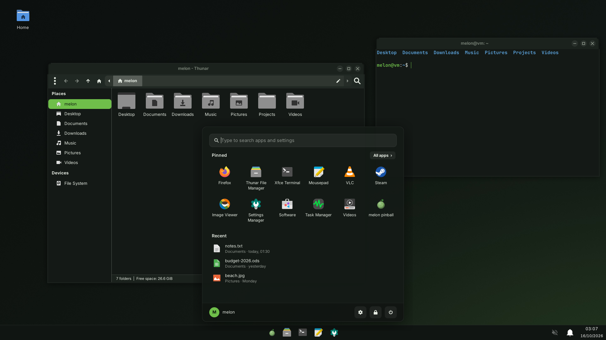
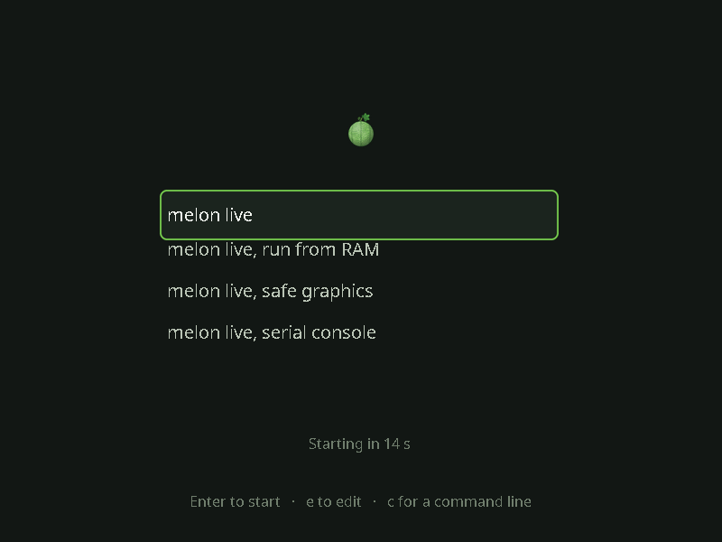

# melon Linux

> **Contributing: open pull requests against the `testing` branch only, never `main`.**
> `main` is the stable branch that ISOs and the package repository are built from. Changes reach it only
> when the owner has personally reviewed and tested them on `testing` and decides to bring them over.
> Pull requests against `main` will be closed.

A from-scratch, rolling x86_64 distribution:

| | |
|---|---|
| libc | musl 1.2.5 |
| userland | BusyBox 1.37 |
| init | runit 2.3 |
| packages | apk-tools 3 (signed apk v3 packages, binary + source recipes) |
| kernel | Linux 7.0, generic flavour |
| boot | GRUB 2.14, one ISO and one install that boot on both BIOS and UEFI |
| root fs | XFS (FAT32 `/boot`) |
| shell | bash 5.3 |
| desktop | Wayfire (Wayland) with LXQt's panel, launcher and file manager; Flatpak for Steam and other glibc apps; KDE Plasma and more desktops as online installs |
| 32-bit edition | i686 (Pentium M, Pentium 4, Atom netbooks such as the MSI Wind U100) with LXQt on Wayland (labwc) |

## Layout

```
scripts/toolchain.sh   builds the x86_64-melon-linux-musl cross toolchain (binutils 2.46, GCC 15.2, musl)
scripts/melon-build    builds one recipe into signed .apk packages and reindexes the repo
scripts/mkiso.sh       assembles the hybrid BIOS/UEFI live ISO from the repo
recipes/<pkg>/MELONBUILD   package recipes (APKBUILD-like)
iso-files/init         live initramfs init
branding/              logo
site/                  the website (published to the gh-pages branch by scripts/publish-site.sh)
art/site.py            draws the website's pixel melon and netting
recipes/calamares-melon/   graphical installer branding and the 200-question gauntlet
```

## Building

Sources come from upstream releases (`scripts/fetch-sources.sh`, into `sources/`; older recipes still use the Ubuntu
source archive's copies of the same tarballs, and new ones come straight from upstream). Then:

```sh
scripts/toolchain.sh
for p in melon-layout linux-headers musl gcc-runtime zlib zstd openssl apk-tools busybox ncurses bash runit \
         util-linux userspace-rcu inih xfsprogs grub libnl3 wpa_supplicant alsa-lib alsa-utils mpg123 \
         linux-firmware linux-melon melon-base melon-sounds; do scripts/melon-build $p; done
scripts/mkiso.sh
```

The build machine can be Ubuntu 24.04 (or WSL2, also on Windows 10: see BUILDING.md for its traps), Debian or Devuan, or **melon itself**: `scripts/host-setup.sh`
notices which one it runs on and installs the build tools with `apt` or with melon's own `apk`. `BUILDING.md` has
them all, including what to keep and what to rebuild when moving a build machine.

Packages are signed with `keys/melon-signing.rsa` (not committed; generate your own with
`openssl genrsa -out keys/melon-signing.rsa 4096` and put the public half in `keys/`).

## Installing

Boot the ISO. The graphical installer (desktop ISO) is Calamares. There is also a quick console
installer for people who know its name (it got a new name, song and intro art on 8 October 2026; the old name no longer works).

## Desktop

Since 12 October 2026 melon's desktop is **Wayfire**, a light Wayland compositor, with LXQt's panel, application menu,
launcher, notifications and file manager on top (LXQt's own Wayfire session). It starts quicker and takes much less room
on the ISO than KDE Plasma, which it replaces as the default. What comes with it:

| | |
|---|---|
| panel and menu | LXQt panel at the bottom: the melon menu button, task list, tray (network, volume, battery), clock |
| launcher | Alt+Space (LXQt runner), or the Super key for the menu |
| notifications | LXQt's notification daemon |
| files, terminal | PCManFM-Qt (also draws the desktop and wallpaper), QTerminal |
| network, sound, Bluetooth | nm-tray (NetworkManager), the panel's volume control and pavucontrol-qt (PipeWire) |
| lock screen | swaylock, after 10 minutes idle (swayidle), before sleep, or Super+L |
| screenshots | Print (grim, into `~/Pictures/Screenshots`) |
| login | SDDM with melon's theme, on labwc |

Keys: Super+Enter terminal, Super+E files, Super+W all windows, Super+arrows to tile, Ctrl+Super+Left/Right to switch
workspaces. Wayfire's settings are in `~/.config/lxqt/wayland/lxqt-wayfire.ini` (copied from
`/etc/xdg/lxqt/wayland/lxqt-wayfire.ini` on the first login).

**Plasma:** `sudo apk add melon-plasma`, then pick "Plasma (Wayland)" on the login screen. It brings back the Plasma set the
desktop ISO used to carry (Dolphin, Konsole, Spectacle, Discover), with melon's Plasma colours.

**Coming in 0.6: XFCE with a look of its own.** XFCE becomes the default desktop in 0.6 (`docs/xfce-desktop-plan.md`), and it
won't look like stock XFCE: a libadwaita-style GTK theme in melon's colours, melon's own window frames (minimise, maximise and
close on every window), Papirus-Dark icons with grey folders, Inter and JetBrains Mono, and a bottom taskbar with the apps
centred on the screen and melon's own start menu (`melon-menu`: search, pinned apps, recent files, lock and power, in a rounded
card above the taskbar; Super opens it), the owner's pick. Qt, GTK and Flatpak apps share one theme, font and cursor, and
`melon-check-look` tests that in the desktop-install test once XFCE is on the ISO. The packages are in the tree (`melon-xfce`, `melon-menu`, `adw-gtk3`,
`papirus-icon-theme`, `font-inter`, `font-jetbrains-mono`); XFCE itself is built next. Design and screenshots:
[`docs/xfce-theme.md`](docs/xfce-theme.md).



**Look:** dark, calm surfaces with melon green used only as an accent (selection, focus, links, the lock screen's ring),
a quiet gradient wallpaper, and the melon itself only on the menu button, the boot menu and the installer. The boot menu
(GRUB) is the same on BIOS and UEFI, on the ISOs and on installed systems: a small melon, the entries in a readable font,
the selected one outlined in green, a countdown and one line of help.



**Size and start-up time:** the 0.4 desktop ISO with Plasma was 793.6 MB. Plasma, its apps and the KDE libraries only they
used come to about 110 to 145 MB of compressed packages; the Wayfire and LXQt set that replaces them is about 15 MB, so
the next desktop ISO should be roughly 120 MB smaller (the exact number comes with the first ISO built with it). To measure
start-up time on an installed system, run `melon-boottime` after logging in: it lists when `sddm`, `wayfire`,
`lxqt-session`, `lxqt-panel` and `pcmanfm-qt` started, counted from the kernel's start (with Plasma it showed `kwin_wayland`
and `plasmashell`).

## Website

[melon-77.github.io/melon-os](https://melon-77.github.io/melon-os/) is the `site/` folder, served from the `gh-pages` branch.
It is plain HTML and CSS (fonts hosted in the folder, no trackers) plus a small demo of the installer's gauntlet. The big
melon in the first screen is `melonfetch`'s own, redrawn by `art/site.py`. The site also hosts the
[distro finder](https://melon-77.github.io/melon-os/distro-finder/), a quiz that scores more than a hundred Linux
distros, melon included, against your answers. Change the site through a pull request to `testing` like everything else;
after it is merged, `scripts/publish-site.sh` puts `site/` on `gh-pages`. The site's download page lists each ISO with its
size and SHA-256, read from `site/releases.json`: after a release, `scripts/site-release.py update --tag <tag>` refreshes it (the 32-bit pre-release too: `update --tag i686-<date> --editions x86-desktop,x86-console`); `docs/iso-hosting.md` compares free file hosts for the ISOs (SourceForge, Internet Archive, Cloudflare R2) and
`scripts/upload-isos.sh` uploads to them. The download buttons point to SourceForge (project `melonl`).

## 32-bit edition (old netbooks)

melon also builds for 32-bit PCs with SSE2 (Pentium M, Pentium 4, Intel Atom: the MSI Wind U100 and similar netbooks).
Its desktop is the same **LXQt** shell as the 64-bit edition, on the even lighter labwc compositor, comfortable in 1–2 GB of RAM,
with zram swap and drivers for every graphics and network chip an old 32-bit netbook or laptop is likely to have: Intel GMA, old Radeon (r300, r600) and GeForce (nouveau) graphics; Atheros, Ralink, Realtek, Intel 3945/4965 and Broadcom Wi-Fi, USB Wi-Fi sticks and the usual wired chips; the MSI Wind's Fn keys and radio switch (msi-laptop). It
uses the same installers (Calamares with the gauntlet, the console installer). Flatpak and the NVIDIA drivers are
64-bit only. Build it with `MELON_ARCH=x86` (`BUILDING.md`); the ISOs are `melon-*-i686.iso` and
`melon-desktop-*-i686.iso`. Status (7 October 2026): both ISOs are built, signed with melon's key and pass their install tests on an emulated
Atom N270 with 2 GB of RAM (LXQt logs in through SDDM, printing works); the 32-bit packages are in the online
repository (`packages/x86`); the ISOs are on the pre-release `i686-20261007`; a test on a real U100 comes next. NetHack and
the QEMU guest agent aren't in the 32-bit edition yet.

## Developer tools

Compilers and build tools come from the package repository (they're not on the ISOs), for example:

```sh
sudo apk add gcc g++ make pkgconf      # also offered on first login
sudo apk add clang go cmake meson git github-cli
sudo apk add qemu ovmf                  # virtual machines with KVM, BIOS and UEFI
```

**Claude Code** runs on melon. Anthropic's installer recognises musl and installs its musl build for your user:

```sh
sudo apk add bash curl ca-certificates libgcc libstdc++ ripgrep
curl -fsSL https://claude.ai/install.sh | bash
echo 'export USE_BUILTIN_RIPGREP=0' >> ~/.bashrc    # Claude Code then searches with melon's ripgrep
```

## Boot time

An installed system that has no other operating system next to it skips its boot menu after 1 second (hold Shift or press Esc
to open it; "safe graphics" is in there; `GRUB_TIMEOUT` and `GRUB_TIMEOUT_STYLE` in `/etc/default/grub` change this, and
`sudo melon-update-grub` applies it). Next to Windows the menu still shows for 5 seconds. Startup no longer waits for every
device to be probed: it mounts as soon as the disks are there and lets the graphics driver, Wi-Fi and sound finish while the
services start (`melon.udev=sync` on the kernel command line brings the old, slower order back if a machine misbehaves), and
services that wait for each other check every 20 ms instead of every 0.42 s. `melon-boottime` shows where a boot's time went:
the milestones of stage 1 and when the main daemons started, to 10 ms.

## Smaller ISOs

The desktop ISO is being slimmed from 794 MB by taking out only what nothing on a PC uses; what leaves the ISO stays one command away
(details and measurements in AGENTS.md, "Desktop ISO size"). In the repository now:

- Intel Wi-Fi firmware keeps the one version the kernel loads, and firmware for hardware that is not in PCs and laptops (SoC boards,
  phone and router Wi-Fi chips, big server network cards) moves to `linux-firmware-extra`, and the ISOs install `linux-firmware-pc` (all
  but that part): if you use such hardware, `sudo apk add linux-firmware-extra`. Installed systems that upgrade keep everything.
- The kernel is stored once on the ISO, Breeze's default wallpaper is a high-quality JPEG, and the ISOs are squashed with zstd level 19.

**NVIDIA graphics:** on a computer with an NVIDIA card (GTX 16/RTX 20 and newer), `melon-first-boot` offers the open
driver (`sudo apk add linux-firmware-nvidia mesa-nvk`: nouveau with NVK, the desktop and games use the card) or NVIDIA's
own kernel driver (`sudo apk add nvidia-open`: Flatpak games get NVIDIA's libraries from Flathub; the desktop can't use
them, as they need glibc). Restart after installing either.
