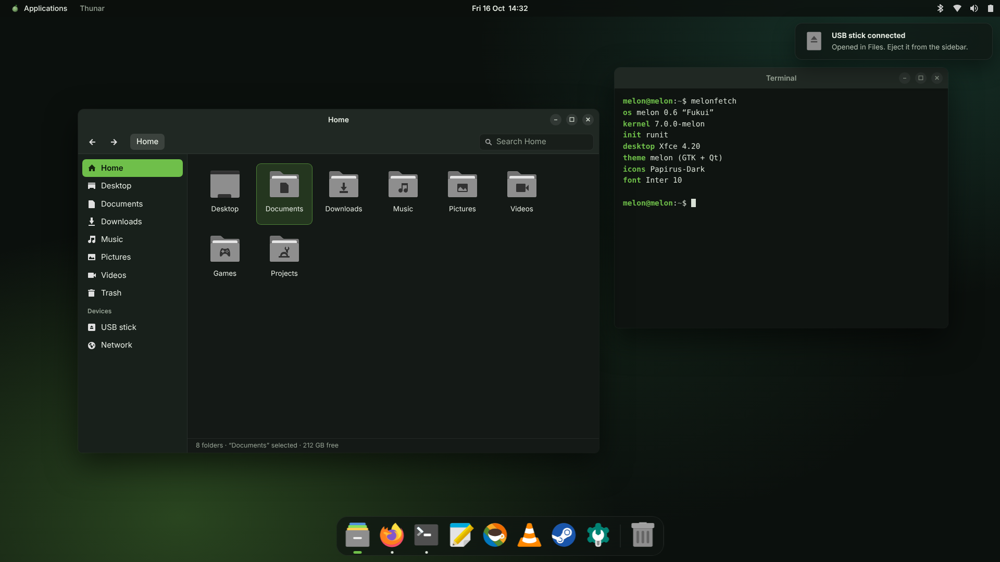
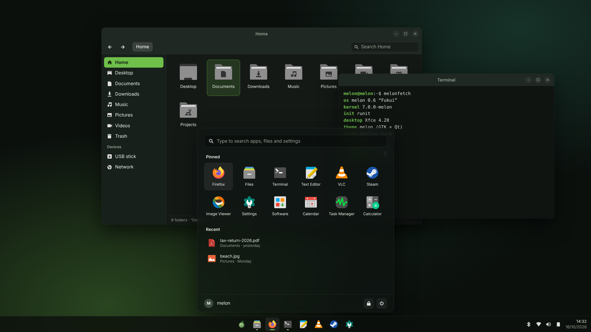

# melon's XFCE look: design

The owner (16 October 2026): "lets make a really good modern theme for it that makes it look comparable to like macos or
windows / kde instead of it just being base garbage xfce like all distros provide". This file is the design for the look of
the XFCE desktop that becomes the default in 0.6 (`docs/xfce-desktop-plan.md`). It sits on top of that plan: the plan says
what to build, this says how it should look and which packages carry the look.

It keeps melon's existing rules (AGENTS.md, "melon's look"): dark grey-green surfaces, light text, melon green `#6fbf4a`
only where it means something (selection, focus, links, the lock screen's ring), and the melon itself only on the menu
button, the boot menu and the installer.

## Mockups

Both are drawn with the real pieces (Inter, Papirus-Dark, the palette below) in HTML and rendered at 1920x1080
(`art/xfce-mockup.py`). Thunar, the terminal and the panel are what XFCE can actually do with the packages listed under
"Packages"; nothing in them needs a patched XFCE.

**Layout A, top bar and dock** (macOS-like):

**Layout B, bottom taskbar** (Windows 11 and KDE-like), with the start menu open:

Both share everything except the panel. The owner picks one as the default; the other can be offered as a one-click switch
later (`xfce4-panel-profiles`).

## The pieces

| Part | Choice | Why |
|---|---|---|
| GTK theme | **adw-gtk3-dark**, recoloured to melon's palette with a `gtk.css` override (`@define-color` for window, view, headerbar, sidebar, accent) | The libadwaita look for GTK 3 apps: flat, rounded, modern. 1.3 MB. Upstream keeps it current with GNOME; melon only changes colours, so updates stay a version bump. |
| Window frames | **melon's own xfwm4 theme** (`melon`), drawn by `art/xfwm4theme.py` | xfwm4 themes are XPM/PNG pieces. Ours: a 40 px title bar in the header colour so it joins the app's toolbar, 11 px rounded top corners, centred title in Inter Semibold, three small round buttons (close turns red on hover, the others light up grey), a 1 px border, no gradients. |
| Icons | **Papirus-Dark** with grey folders (`papirus-folders -C grey`, done at build time) | Complete (46 000 icons, every app melon ships), consistent, readable at 16 px. 21 MB compressed (xz), within the 45 MB "may go on an ISO" line. |
| Fonts | **Inter** for the interface (10 pt), **JetBrains Mono** for terminals, Noto for everything else (already there) | Inter is the font of modern UIs (GNOME 48, many macOS-like setups). Subpixel off, slight hinting, greyscale antialiasing: the macOS/Windows 11 rendering. |
| Cursor | **Adwaita** at 24 px | Neutral, crisp, already in GTK's stack; set everywhere (see "One look everywhere"). |
| Panel | Layout A: a 32 px top panel (Whisker menu with the melon, window title, clock in the middle, tray) and a dock (`xfce4-docklike-plugin`) in a second, auto-sized, floating panel. Layout B: one 52 px bottom panel with the Whisker menu and docklike centred, tray and a two-line clock on the right. | `docklike` is the plugin that gives XFCE pinned and running apps in one strip with dots for running windows, like a dock or the Windows 11 taskbar. |
| Start menu | **xfce4-whiskermenu-plugin**, styled with `gtk.css` (rounded 16 px, search on top, favourites as a grid, recent files, user and power buttons at the bottom) | XFCE's best menu, with search over apps, files and settings. |
| Panel look | Glass: `rgba(16,21,18,.70)` background; under X11 the blur needs a compositor, so xfwm4's own compositor gives the transparency and drop shadows (no blur), and the colour is dark enough to read without it | Real blur needs picom; it's an option for later, not needed for the look. |
| Notifications | **xfce4-notifyd** with a melon theme: rounded cards at top right, icon, bold title, dim body | Fits the panel and the menu. |
| Lock screen | **xfce4-screensaver**'s lock dialog, themed: the wallpaper dimmed, a clock, the user's picture and a password field with the green focus ring | The same ring as swaylock's on the Wayfire desktop. |
| Login screen | SDDM's `melon` theme stays | Already calm and dark. |
| Wallpaper | The existing quiet dark gradient (`art/wallpaper.py`), with a little more depth: two soft green and teal glows, as in the mockups | Gives the glass panel something to sit on; still no picture, no pattern. |
| Window effects | xfwm4 compositor on: shadows under windows and menus, no fading delays, no wobbly anything | Shadows are most of what makes windows look "modern". |

## Palette

| Name | Colour | Used for |
|---|---|---|
| desktop | `#121714` | wallpaper base |
| window | `#1b221d` | window background |
| view | `#141916` | lists, file views, text areas |
| header | `#202823` | title bars, toolbars, headerbars |
| sidebar | `#18201b` | Thunar's and settings' sidebars |
| text | `#e6ece3` | text |
| dim text | `#97a395` | secondary text, status lines |
| accent | `#6fbf4a` | selection, focus ring, switches, links, the active app's mark in the panel |
| on accent | `#0b150c` | text on a green selection |
| danger | `#e05d4f` | the close button on hover, destructive buttons |

## One look everywhere (desktop goal: "Look")

`docs/desktop-goals.md` has a row: fonts, cursor and theme are the same in Qt apps, GTK apps and Flatpak apps. How the
XFCE desktop meets it:

- **GTK 3 and 4:** xsettings (`xfsettingsd`) carries `Net/ThemeName=melon`, `Net/IconThemeName=Papirus-Dark`,
  `Gtk/FontName=Inter 10`, `Gtk/CursorThemeName=Adwaita`, `Gtk/CursorThemeSize=24`. GTK 4 apps that use libadwaita follow
  `org.gnome.desktop.interface color-scheme=prefer-dark` and `accent-color=green` (gsettings default override in
  `melon-xfce`).
- **Qt 5 and 6:** `QT_QPA_PLATFORMTHEME=gtk3` (Qt's own GTK platform theme reads the GTK theme's colours, the font and the
  icon theme) set in `/etc/xdg/xfce4/xinitrc`'s environment through `/etc/profile.d/melon-xfce.sh`, with Calamares
  excepted (it keeps its own branding). Qt picks the cursor up from `XCURSOR_THEME`/`XCURSOR_SIZE`.
- **Cursor everywhere:** `/usr/share/icons/default/index.theme` inherits Adwaita (X11's fallback, used by Xwayland apps
  and anything that ignores xsettings), and `XCURSOR_THEME=Adwaita XCURSOR_SIZE=24` in the session.
- **Flatpak:** a system-wide override (`/var/lib/flatpak/overrides/global`) sets `GTK_THEME=adw-gtk3-dark`, and
  `melon-first-boot` installs `org.gtk.Gtk3theme.adw-gtk3-dark` from Flathub along with the apps it offers; GTK 4 Flatpak
  apps read the colour scheme and accent through `xdg-desktop-portal-gtk`'s settings portal, which reads the same gsettings.
  Fonts and icons come from the host through `--filesystem=xdg-data/icons:ro` and fontconfig's host font sharing, which
  Flatpak does by default.

**Automated check** (`scripts/check-look.sh`, run by `qemu-test.py desktop` and `desktop-install` inside the logged-in
session): it reads `xfconf-query -c xsettings` (theme, icons, font, cursor), `gsettings get org.gnome.desktop.interface`
(colour scheme, font, cursor), the session's `QT_QPA_PLATFORMTHEME`, `XCURSOR_THEME` and `/usr/share/icons/default/index.theme`,
asks a small Qt program (`qtpaths`-style probe in `melon-xfce`: prints `QApplication::font()`, the style and
`QIcon::themeName()`) and a GTK one (`gtk-query-settings`) what they really got, and `flatpak override --show` for the
global override. Any mismatch fails the test with the two values side by side. The screenshot (`logs/qemu-desktop.ppm`)
is still for a human to look at.

## Packages

| Package | What | Source | ISO size (compressed) |
|---|---|---|---|
| `adw-gtk3` | GTK 3 theme | upstream release tarball (github.com/lassekongo83/adw-gtk3), sha512 cross-checked against Alpine's APKBUILD | < 1 MB |
| `papirus-icon-theme` | icons, folders recoloured grey at build time; the `ePapirus`, `ePapirus-Dark` and `Papirus-Light` variants dropped | upstream tag (github.com/PapirusDevelopmentTeam/papirus-icon-theme) | about 21 MB |
| `font-inter` | Inter | upstream release zip (github.com/rsms/inter) | about 2 MB (variable font only) |
| `font-jetbrains-mono` | JetBrains Mono | upstream release zip | about 1 MB |
| `xfce4-docklike-plugin` | the dock / taskbar strip | archive.xfce.org | < 1 MB |
| `xfce4-whiskermenu-plugin` | start menu | archive.xfce.org (already in the XFCE plan) | < 1 MB |
| `melon-xfce` | the `melon` GTK colours override, the xfwm4 theme, xfconf defaults (xsettings, xfwm4, panel layout, whiskermenu, notifyd, screensaver), gsettings override, `profile.d` environment, cursor default, Flatpak global override, `check-look.sh` | melon (art scripts in `art/`) | < 1 MB |

About 26 MB on the desktop ISO for the whole look. Nothing here is Rust; `librsvg` (Rust, already in the XFCE plan) is what
draws the SVG icons, so "remove everything built with Rust" takes the icons' rendering with it, as it takes the rest.

## Order of work

1. The owner picks layout A or B.
2. Recipes: `adw-gtk3`, `papirus-icon-theme`, `font-inter`, `font-jetbrains-mono`, `xfce4-docklike-plugin` (the last in
   `gen-xfce-recipes.py` with the other XFCE tarballs). Versions and checksums are taken on the build machine (the cloud
   session can't reach GitHub release pages or archive.xfce.org); the mockups used Alpine's builds of the same releases.
3. `art/xfwm4theme.py` draws the xfwm4 theme; `melon-xfce` carries it with the colour override and the defaults.
4. `scripts/check-look.sh` and its hook in `qemu-test.py`.
5. Screenshots from a real XFCE session (`qemu-test.py desktop`) replace the mockups here and in the README.
