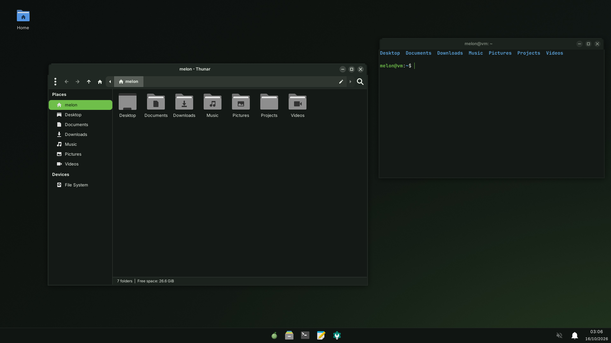

# melon's XFCE look: design

The owner (16 October 2026): "lets make a really good modern theme for it that makes it look comparable to like macos or
windows / kde instead of it just being base garbage xfce like all distros provide". This file is the design for the look of
the XFCE desktop that becomes the default in 0.6 (`docs/xfce-desktop-plan.md`). It sits on top of that plan: the plan says
what to build, this says how it should look and which packages carry the look.

It keeps melon's existing rules (AGENTS.md, "melon's look"): dark grey-green surfaces, light text, melon green `#6fbf4a`
only where it means something (selection, focus, links, the lock screen's ring), and the melon itself only on the menu
button, the boot menu and the installer.

## The layout: a bottom taskbar (the owner's pick, 16 October 2026)

A taskbar at the bottom: the start button (the melon) and the apps centred on the screen (docklike: pinned and running apps
in one strip, a green bar under the active one), the tray, sound, battery, notifications and a two-line clock at the right.
The start menu is melon's own (`melon-menu`), built to the bottom-taskbar mockup: a rounded card centred above the taskbar
with the search field, the pinned apps as a grid, the files opened last, and the user with settings, lock and power at the
bottom. Every window keeps **minimise, maximise and close** buttons (the owner: windows without them are "stupid and
inconvenient"): xfwm4's frames and the title bars GTK and libadwaita apps draw themselves, which show only close unless told.

Screenshots of melon-xfce's and melon-menu's files in a real XFCE session (XFCE 4.18 from Ubuntu 24.04 and docklike 0.4.2 on
Xvfb, the closest the cloud session can run; melon's own XFCE build is still to come). Firefox, VLC, Steam and the other
first-boot apps in the menu are stand-in launchers there, and the recent files are test files:

The first mockups (drawn with `art/xfce-mockup.py`, the real icons and font in HTML) show both layouts that were offered:
[top bar and dock](images/xfce-layout-a.png) and [bottom taskbar](images/xfce-layout-b.png).

## The pieces

| Part | Choice | Why |
|---|---|---|
| GTK theme | **adw-gtk3-dark**, recoloured to melon's palette with a `gtk.css` override (`@define-color` for window, view, headerbar, sidebar, accent) | The libadwaita look for GTK 3 apps: flat, rounded, modern. 1.3 MB. Upstream keeps it current with GNOME; melon only changes colours, so updates stay a version bump. |
| Window frames | **melon's own xfwm4 theme** (`melon`), drawn by `art/xfwm4theme.py` | xfwm4 themes are PNG/XPM pieces. Ours: a 36 px title bar in the header colour, 10 px rounded top corners, centred title in Inter Semi-Bold, three round buttons (minimise, maximise, close; close turns red under the pointer), a thin light outline, no gradients. Buttons are opaque: without the compositor xfwm4 turns partial alpha into a 1-bit mask, which cut a first version's minimise line and the circles away. |
| Icons | **Papirus-Dark** with grey folders (`papirus-folders -C grey`, done at build time) | Complete (46 000 icons, every app melon ships), consistent, readable at 16 px. 21 MB compressed (xz), within the 45 MB "may go on an ISO" line. |
| Fonts | **Inter** for the interface (10 pt), **JetBrains Mono** for terminals, Noto for everything else (already there) | Inter is the font of modern UIs (GNOME 48, many macOS-like setups). Subpixel off, slight hinting, greyscale antialiasing: the macOS/Windows 11 rendering. |
| Cursor | **Adwaita** at 24 px | Neutral, crisp, already in GTK's stack; set everywhere (see "One look everywhere"). |
| Panel | Two 48 px panels at the bottom: panel 1 the full width (systray, PulseAudio, power, notifications and the clock, time over date, at the right), panel 2 on top of it, centred, transparent and as wide as its contents (the start button, then docklike) | XFCE's panel can't centre a group while other plugins sit at one end: two expanding separators split the space that's left, so the group sat half the tray's width left of centre. `docklike` gives XFCE pinned and running apps in one strip, like the Windows 11 taskbar. It pins only apps every install has (Thunar, terminal, Mousepad, settings): a pinned Flatpak app that isn't installed yet shows as a blank gear. |
| Start menu | **melon-menu**, melon's own (one C file, GTK 3): a 640 px card with 14 px corners and its own shadow, centred above the taskbar; search over apps and settings (Enter starts the best match), "Pinned" as a six-column grid, "Recent" with the last four files and their folder and day, "All apps" as an A to Z list, the user's initial, name, settings, lock and a power menu (sleep, restart, shut down, log out) at the bottom; right click pins or unpins | Whisker, XFCE's usual menu, was tried first: its window is square on X11, it opens at the button's left edge rather than centred, and its layout (categories column, a row of coloured action icons) looked like a replica of a modern menu rather than one. melon-menu stays running hidden from login (autostart, `--background`), so the taskbar's button and the Super key open it at once; pins live in `melon/menu.conf` (`/etc/xdg/melon-xfce`, then the user's copy). |
| Panel look | Near-black `#101512` with a thin light line on top (`panel.png`, drawn by `art/xfce-panel.py`: a theme border would be drawn twice over the centred panel), rounded hover and pressed states for its buttons | No blur on X11 without picom; the colour is dark enough to read without it. |
| File manager | Thunar without its menu bar (its menu is a button in the toolbar then), the path as buttons, roomier sidebar rows, and Documents, Downloads, Music, Pictures and Videos in the sidebar (GTK bookmarks, written once at the first login) | Close to the mockup's Files window. |
| Notifications | **xfce4-notifyd** with a melon theme: cards at top right, icon, bold title, dim body | Fits the panel and the menu. |
| Terminal | xfce4-terminal in JetBrains Mono 11, the view colour as background, a 16-colour palette with melon green, no menu bar | The default black terminal was the one thing that still looked stock. |
| Lock screen | **xfce4-screensaver**'s lock dialog, themed: the wallpaper dimmed, a clock, the user's picture and a password field with the green focus ring | The same ring as swaylock's on the Wayfire desktop. |
| Login screen | SDDM's `melon` theme stays | Already calm and dark. |
| Wallpaper | The existing quiet dark gradient (`art/wallpaper.py`), set on every monitor at the first login (`melon-set-wallpaper`) | Still no picture, no pattern. |
| Window effects | xfwm4 compositor on: shadows under windows and menus, no fading delays, no wobbly anything | Shadows are most of what makes windows look "modern". |

## Palette

| Name | Colour | Used for |
|---|---|---|
| desktop | `#121714` | wallpaper base |
| window | `#1b221d` | window background |
| view | `#141916` | lists, file views, text areas |
| header | `#202823` | title bars, toolbars, headerbars |
| sidebar | `#18201b` | Thunar's and settings' sidebars |
| text | `#e6ece3` | text |
| dim text | `#97a395` | secondary text, status lines |
| accent | `#6fbf4a` | selection, focus ring, switches, links, the active app's mark in the panel |
| on accent | `#0b150c` | text on a green selection |
| danger | `#e05d4f` | the close button on hover, destructive buttons |

## One look everywhere (desktop goal: "Look")

`docs/desktop-goals.md` has a row: fonts, cursor and theme are the same in Qt apps, GTK apps and Flatpak apps. How the
XFCE desktop meets it:

- **GTK 3 and 4:** xsettings (`xfsettingsd`) carries `Net/ThemeName=melon`, `Net/IconThemeName=Papirus-Dark`,
  `Gtk/FontName=Inter 10`, `Gtk/CursorThemeName=Adwaita`, `Gtk/CursorThemeSize=24`. GTK 4 apps that use libadwaita follow
  `org.gnome.desktop.interface color-scheme=prefer-dark` and `accent-color=green` (gsettings default override in
  `melon-xfce`).
- **Qt 5 and 6:** `QT_QPA_PLATFORMTHEME=gtk3` (Qt's own GTK platform theme reads the GTK theme's colours, the font and the
  icon theme) set in `/etc/xdg/xfce4/xinitrc`'s environment through `/etc/profile.d/melon-xfce.sh`, with Calamares
  excepted (it keeps its own branding). Qt picks the cursor up from `XCURSOR_THEME`/`XCURSOR_SIZE`.
- **Cursor everywhere:** `/usr/share/icons/default/index.theme` inherits Adwaita (X11's fallback, used by Xwayland apps
  and anything that ignores xsettings), and `XCURSOR_THEME=Adwaita XCURSOR_SIZE=24` in the session.
- **Flatpak:** melon-xfce's install script adds a system-wide override, `GTK_THEME=melon` and `~/.themes` shared
  read-only, and `melon-xfce-session` copies the GTK parts of `melon`, `melon-gold` and `adw-gtk3-dark` into `~/.themes` at
  each login (inside the sandbox GTK finds themes in `~/.themes`; Flatpak remaps `~/.local/share`). Only the GTK parts: a copy
  of the xfwm4 frames there would hide newer ones in `/usr/share/themes`. GTK 4 Flatpak apps read the colour scheme through
  the settings portal; fonts come from the host, which Flatpak shares by default. X11 apps in the sandbox get XSETTINGS from
  the X server like any other.

**Automated check:** `/usr/libexec/melon/melon-check-look` (melon-xfce), which `qemu-test.py desktop-install` runs in the
logged-in user's session on any desktop that ships it. It compares xfconf's settings with what each toolkit really gets:
GTK 3 (`gtk-query-settings`), GTK 4 and Flatpak (`gsettings`), Qt (`melon-look-probe-qt`, a small Qt program in melon-xfce
that prints the font, icon theme and palette a Qt app received), the X cursor (`XCURSOR_*`, the `Xcursor.theme` resource,
`/usr/share/icons/default/index.theme`), the window buttons (xfwm4's layout and GTK's decoration layout) and Flatpak's
override and theme copy. One line per check; any mismatch fails the test with both values. In the Ubuntu session above all
28 checks passed (the Qt probe ran with Qt 6.12; Qt 6.4's GTK theme doesn't pass GTK's colours on, which the check catches).

## Packages

| Package | What | Source | ISO size (compressed) |
|---|---|---|---|
| `adw-gtk3` | GTK 3 theme | upstream release tarball (github.com/lassekongo83/adw-gtk3), sha512 cross-checked against Alpine's APKBUILD | < 1 MB |
| `papirus-icon-theme` | icons, folders recoloured grey at build time; the `ePapirus`, `ePapirus-Dark` and `Papirus-Light` variants dropped | upstream tag (github.com/PapirusDevelopmentTeam/papirus-icon-theme) | about 21 MB |
| `font-inter` | Inter | upstream release zip (github.com/rsms/inter) | about 2 MB (variable font only) |
| `font-jetbrains-mono` | JetBrains Mono | upstream release zip | about 1 MB |
| `xfce4-docklike-plugin` | the dock / taskbar strip | archive.xfce.org | < 1 MB |
| `melon-menu` | the start menu, its taskbar launcher (`melon-menu.desktop`, icon `melon-start`: melon.svg cropped to the fruit) and its autostart entry | melon (`recipes/melon-menu/melon-menu.c`) | < 0.1 MB |
| `melon-xfce` | the `melon` GTK colours override, the xfwm4 theme, the taskbar background, xfconf defaults (xsettings, xfwm4, panel layout, Thunar, notifyd, screensaver), melon-menu's pins, gsettings override, `profile.d` environment, cursor default, Flatpak override, `melon-check-look` and its Qt probe | melon (art scripts in `art/`) | < 1 MB |

About 26 MB on the desktop ISO for the whole look. Nothing here is Rust; `librsvg` (Rust, already in the XFCE plan) is what
draws the SVG icons, so "remove everything built with Rust" takes the icons' rendering with it, as it takes the rest.

## What is done, and what the XFCE build still has to do

Done (this pull request): the recipes `adw-gtk3`, `papirus-icon-theme` (grey folders), `font-inter`, `font-jetbrains-mono`
and `melon-xfce` (`XFCE_LOOK` in `build-everything.sh`); the frames (`art/xfwm4theme.py`); the defaults in
`/etc/xdg/melon-xfce` (xsettings, xfwm4, the two-panel taskbar, docklike, Thunar, notifications, screen saver, desktop icons,
terminal, GTK `settings.ini`, melon-menu's pins); the start menu (`recipes/melon-menu`); the gsettings override; the session
setup (Super opens the menu, the sidebar bookmarks, the wallpaper); the gold edition for gauntlet survivors (`melon-gold`,
through `melon-survivor-look`); XFCE in `melon-set-wallpaper`; the look check and its hook in `qemu-test.py`.

For the XFCE build (`docs/xfce-desktop-plan.md`), so the look works there:
- `qt6-qtbase` with `-DFEATURE_gtk3=ON` (in `gen-kde-recipes.py`, after `gtk3` is built): without Qt's GTK platform theme
  Qt apps keep Fusion's colours, and the look check fails on Qt.
- `glib` compiles `/usr/share/glib-2.0/schemas` in a trigger, and `gtk3` updates icon caches under `/usr/share/icons` in one:
  melon-xfce and papirus-icon-theme can be installed before them.
- `xfce4-docklike-plugin` (0.5.x, needs libxfce4windowing) in `gen-xfce-recipes.py`, and `melon-menu` in `build-everything.sh`
  after `gtk3`; then melon-xfce's `depends=` gains the XFCE packages, `melon-menu` and `adwaita-icon-theme` (the cursor), and
  `desktop-packages.txt` lists it. melon-menu runs `xflock4` and `xfce4-session-logout`, which XFCE brings.
- Super opens the start menu: `melon-xfce-session` binds `Super_L` to `melon-menu` in `xfce4-keyboard-shortcuts` at the first
  login (tested with XFCE 4.18's xfsettingsd); check that 4.20 still takes a bare `Super_L`.
- Screenshots from `qemu-test.py desktop-install` replace the Ubuntu ones here.
