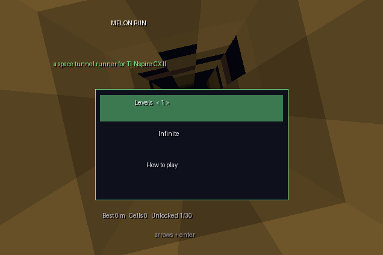
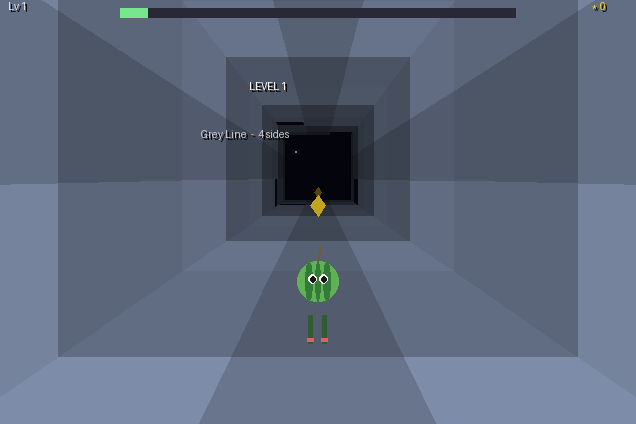
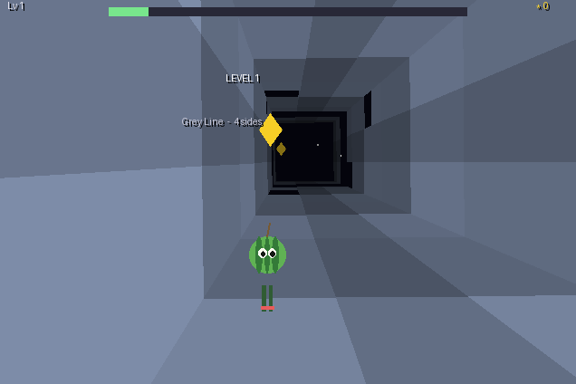
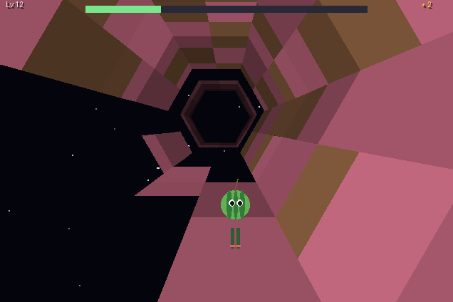

# melon run (TI-Nspire CX II)

A space-tunnel runner for the TI-Nspire CX II (it also runs on the CX and CX CAS, OS 3.6 or later). It is written in
the calculator's own Lua, so you don't need Ndless or a jailbreak: copy `melon-run.tns` to the calculator and open it.

It's a fan game **inspired by the gameplay of Run 3** (by Joseph Cloutier / Player 03): you run down a tunnel floating
in space, step onto a wall to turn the whole tunnel, and jump the gaps. Everything here (the code, the generated levels,
the melon runner and the colours) is melon's own. Nothing is taken from the original game: its levels, art, characters,
story and code belong to its author and can't be redistributed in this repository.

 
 

## Playing

| key | |
|---|---|
| left / right (or 4 / 6) | move one lane; past the edge of the floor you step onto the wall and the tunnel turns |
| up, enter, 8 or space | jump |
| down (or 2) | drop faster |
| esc | pause (esc again: menu) |
| f | show frames per second |

- **Levels:** 30 tunnels, always the same. They get longer and faster, and the tunnel grows from 4 sides to 5, 6, 7 and 8.
  Missing tiles, whole missing walls, stripes, checkerboards, spirals and chasms you must jump. When you fall, you try
  that level again. Reaching a level unlocks it, and the menu lets you start from any unlocked level (left/right on "Levels").
- **Brown tiles are cracked:** you can run across them, but they break if you land on them from a jump.
- **Power cells** (yellow diamonds) are on the safe path through each level.
- **Infinite:** endless random tunnels that keep getting harder; your best distance is kept.

Progress, best distance and cells are kept in the document's variables (`mrunlock`, `mrunbest`, `mruncells`), so
**save the document** (ctrl+S, or answer "yes" when closing it) to keep them.

## Installing

Build `melon-run.tns` (below; it is a build output, so it isn't committed) and send it to the calculator with TI-Nspire CX Student Software / Computer Link, or with
[TiLP](http://lpg.ticalc.org/prj_tilp/) on Linux. Open it from My Documents.

## Building and testing

```sh
nspire/melon-run/build.sh          # LUNA=/path/to/luna if luna isn't on PATH
```

`build.sh` checks the script, then runs two tests with desktop Lua 5.1 (the calculator's Lua version) against a stand-in
for the TI-Nspire API (`tools/sim.lua`), then packs the script into `melon-run.tns` with
[Luna](https://github.com/ndless-nspire/Luna) (`git clone`, `make`, needs zlib):

- `lua5.1 tools/sim.lua bot`: a bot plays all 30 levels with the game's own physics. Every level has to be finished:
  the level generator guarantees a way through (a path that wanders across lanes and walls; chasms no longer than a jump
  at that level's speed, with room to land after them).
- `lua5.1 tools/sim.lua stress`: 40,000 frames of random keys in every screen, which must not raise an error.
- `lua5.1 tools/sim.lua frames DIR` and then `python3 tools/render.py DIR` draw a few scenes as PNG files (with
  Pillow), so you can see the game without a calculator. The screenshots here were made that way.

Not tested yet: a real calculator. The game is drawn with filled polygons, about 100 to 150 a frame. The frame rate on
the CX II hasn't been measured (press `f` in a game to see it). If it's too slow, lower `DRAW` (rows drawn ahead) at the
top of `melon-run.lua`.
